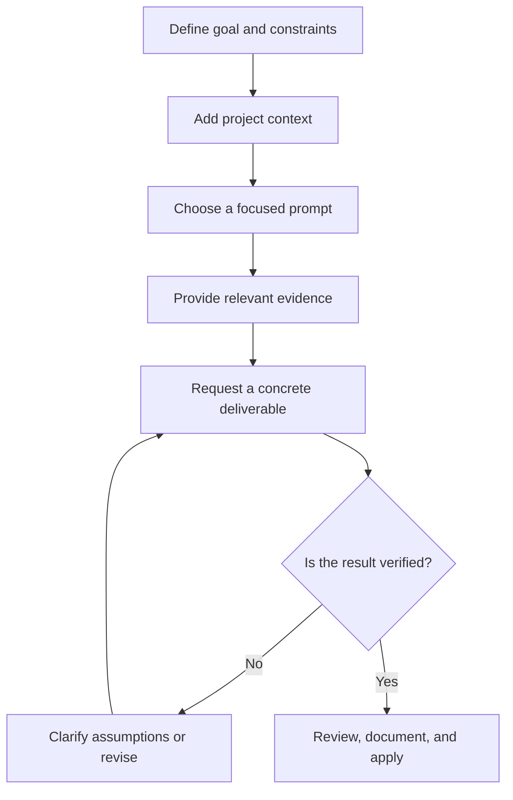

# Universal Project Prompts

A practical, open-source library of reusable prompts for planning, designing, building, testing, reviewing, releasing, and growing software projects. Prompts are organized by task and intended to be adapted to your repository, product, and team.

## Workflow

## Prompt guidelines

1. **Choose a focused prompt.** Pick the closest task from the index below. Combine prompts only when the task crosses categories.
2. **Add project context.** Start with the [project context template](shared/project-context.md) and [technology stack context](shared/tech-stack.md). Include relevant conventions and acceptance criteria.
3. **Replace placeholders.** Fill in bracketed values with facts. Remove irrelevant sections and identify unknowns instead of guessing.
4. **Provide evidence.** Include only the relevant source code, requirements, designs, logs, metrics, or test output. Never include passwords, tokens, API keys, or unnecessary personal data.
5. **Specify the output.** Ask for the format you need, such as a change, comparison, checklist, test plan, or findings with severity and file locations.
6. **Ask for tradeoffs and uncertainty.** Separate confirmed facts from assumptions. For recommendations, request rationale, risks, effort, and conditions that could change the decision.
7. **Validate the result.** For code changes, request focused tests or checks and an honest report of what was actually run. For platform or store guidance, verify current official requirements.
8. **Iterate in small steps.** Use the [workflow prompt](shared/workflow.md) for multi-step tasks. Review output before applying changes or publishing content.

## Prompt index

### Design

- [Universal design](design/universal-design.md)
- [Mobile design](design/mobile-design.md)
- [Flutter conversion](design/flutter-conversion.md)
- [Next.js conversion](design/nextjs-conversion.md)
- [Featured screens](design/featured-screens.md)
- [Email design](design/email-design.md)
- [Onboarding screens](design/onboarding-screens.md)
- [Splash screens](design/splash-screens.md)

### Development

- [Backend](development/backend.md)
- [Database](development/database.md)
- [Mobile](development/mobile.md)
- [Website](development/website.md)

### Marketing

- [Apple App Store](marketing/app-store.md)
- [Google Play Store](marketing/play-store.md)
- [Chrome Web Store](marketing/chrome-web-store.md)
- [Firefox Add-ons](marketing/firefox-add-ons.md)
- [Email content](marketing/email-content.md)
- [Social content](marketing/social-content.md)
- [SEO](marketing/seo.md)
- [Generative engine optimization (GEO)](marketing/geo.md)
- [Answer engine optimization (AEO)](marketing/aeo.md)

### Release and deployment

- [Mobile release](release-deployments/mobile-release.md)
- [Extension release](release-deployments/extension-release.md)
- [Backend deployment](release-deployments/backend-deployment.md)
- [Website deployment](release-deployments/website-deployment.md)

### Review

- [API review](review/api-review.md)
- [Code review](review/code-review.md)
- [Supabase review](review/supabase-review.md)
- [UI review](review/ui-review.md)

### Recommendations

- [Architecture](recommendations/architecture-recommendations.md)
- [Technology stack](recommendations/technology-stack.md)
- [Database](recommendations/database-recommendations.md)
- [API](recommendations/api-recommendations.md)
- [UI/UX](recommendations/ui-ux-recommendations.md)
- [Performance](recommendations/performance-recommendations.md)
- [Security](recommendations/security-recommendations.md)
- [Scalability](recommendations/scalability-recommendations.md)
- [SEO](recommendations/seo-recommendations.md)
- [Monetization](recommendations/monetization-recommendations.md)
- [Feature improvements](recommendations/feature-recommendations.md)
- [Automation and operational efficiency](recommendations/automation-recommendations.md)
- [Product growth](recommendations/product-growth-recommendations.md)

### Shared guidance

- [Master rules](shared/master-rules.md)
- [Coding rules](shared/coding-rules.md)
- [Design rules](shared/design-rules.md)
- [Testing rules](shared/testing-rules.md)
- [Security rules](shared/security-rules.md)
- [Documentation rules](shared/documentation-rules.md)
- [Git rules](shared/git-rules.md)
- [Project context template](shared/project-context.md)
- [Technology stack context](shared/tech-stack.md)
- [Workflow](shared/workflow.md)

### Testing

- [API testing](testing/api-testing.md)
- [Mobile testing](testing/mobile-testing.md)
- [Extension testing](testing/extension-testing.md)
- [UI testing](testing/ui-testing.md)
- [Website testing](testing/website-testing.md)

## Contributing

Contributions are welcome. Keep prompts specific, easy to adapt, and clear about evidence, assumptions, and validation. Follow the existing category structure. When adding or renaming a prompt, update this index and check that its links resolve. Do not include secrets, unsupported claims, or material you do not have permission to redistribute.

## License

This project is licensed under the [MIT License](LICENSE). The license permits use, modification, and redistribution subject to its terms.
